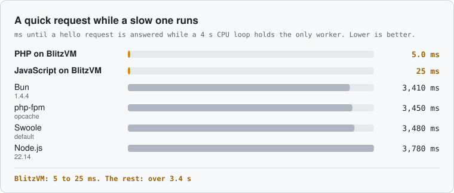
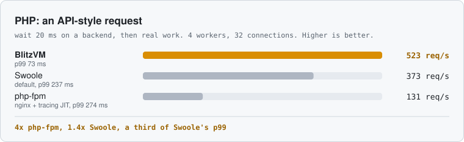
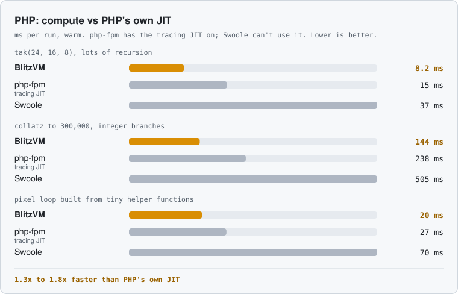
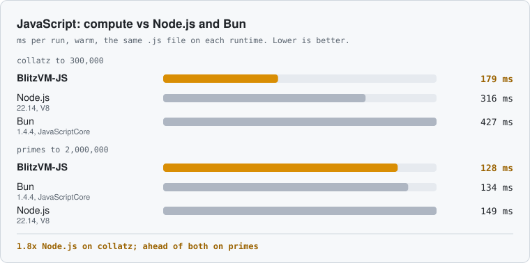
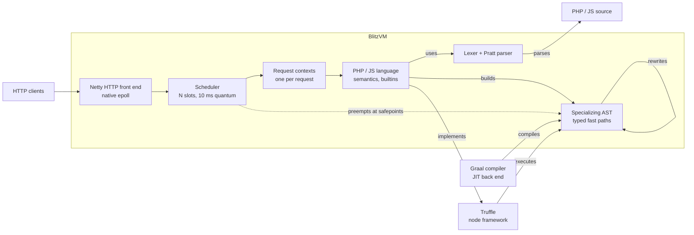

# BlitzVM

**A preemptive runtime for server-side languages.** PHP today, with a JavaScript front end in prototype.

Site: https://blitzvm.returnzero.win/ · By Avinash D'Silva · v0.1 research preview

<picture>
  <source media="(prefers-color-scheme: dark)" srcset="docs/img/latency-dark.svg">
  
</picture>

<picture>
  <source media="(prefers-color-scheme: dark)" srcset="docs/img/api-dark.svg">
  
</picture>

<picture>
  <source media="(prefers-color-scheme: dark)" srcset="docs/img/compute-dark.svg">
  
</picture>

<picture>
  <source media="(prefers-color-scheme: dark)" srcset="docs/img/js-dark.svg">
  
</picture>

Every backend hits this eventually: one heavy request ties up a php-fpm worker, or the whole
event loop in Node and Bun, and everyone queued behind it waits. BlitzVM JIT-compiles hot
code and preemptively schedules requests in short time slices. Each request still starts
with clean state, and you write the same plain PHP or JavaScript handler you would write
today.

How the numbers were taken is under [Benchmarks](#benchmarks); the full comparison,
including the workloads where the other runtimes win, is in
[docs/COMPARISON.md](docs/COMPARISON.md).

## Why it's fast

Most of BlitzVM is custom code: the parsers, the interpreter nodes, the scheduler, the
isolation and the HTTP layer. For turning hot code into machine code it uses the Graal
compiler, the way plenty of languages use LLVM.

**The interpreter rewrites itself, then Graal compiles it.** Source goes through a lexer
and a Pratt parser and comes out as a tree of Truffle nodes. Each node watches the types
flowing through it and specializes. A `+` that has only ever seen integers becomes one
machine add plus an overflow check. A sum that overflows becomes a float, as in PHP 8, and
the next sum of two ints is an int again. When a function gets hot, Graal compiles the interpreter and the
specialized tree together into machine code (partial evaluation). Call sites remember what
they call, so small functions get inlined into their callers. That is where the wins over
PHP's tracing JIT come from: recursion, integer loops, and code split into lots of helpers.

```java
// the integer case: one add, one overflow branch
@Specialization(rewriteOn = ArithmeticException.class)
long doLong(long a, long b) { return Math.addExact(a, b); }

@Specialization
double doDouble(double a, double b) { return a + b; }
```

**Numbers stay machine numbers.** A local variable that only ever holds ints lives in a
64-bit integer slot of the frame, and one that only holds floats lives in a double slot, so
a hot loop runs in registers instead of allocating an object for every value it touches.
Before this, `mandelbrot` allocated around 48 GB of short-lived floats in ten seconds. The
slot's type tag is PHP's type, so `var_dump` and `is_int` see exactly what PHP would show.
A variable that holds both kinds, like the result of `$a * $t / 8`, keeps one boxed value
that every read shares.

**Preemption that keeps working after the JIT kicks in.** There are N CPU slots, and a
request needs one to run. A ticker checks the slots every 5 ms. If a request has had its
10 ms and someone is waiting, the scheduler queues an action on that request's thread. The
action fires at the next safepoint and the slot goes to whoever is next in line. The
safepoint checks are compiled into the machine code at loop back-edges and calls, so a hot
loop can't get away from them.

**One engine, a fresh context per request.** All requests share one engine, which keeps the
parsed trees and the machine code. Each request gets its own context with its own globals,
so you get php-fpm's shared-nothing behaviour without parsing or compiling anything twice.
CPU time is counted per request; a script that blows through its budget is cancelled with
a normal PHP fatal error, and the process (and everyone else) carries on.

**Netty does the HTTP and never runs guest code.** Netty on native epoll parses HTTP; the
event-loop threads only touch sockets and every request goes to a worker that waits for a
CPU slot. One process, one hop. Pipelined requests are answered in order, and a connection
stops reading while one of its requests is in flight, which is a cheap form of backpressure.

## You still write plain PHP

Swoole is fast, but you pay for it in how you write code: the app becomes a long-running
server, requests share its memory, and a CPU-heavy handler blocks whichever worker it lands
on. BlitzVM keeps the php-fpm model and does the scheduling underneath it.

```php
<?php
// report.php: the same file you'd put on php-fpm
$report = build_report($_GET['id']);   // heavy, gets paused every 10 ms
usleep(200000);                         // gives up the CPU while it waits
header('Content-Type: text/html');
echo render($report);                   // and it's all gone after this
```

- **Same model as php-fpm.** One file per request; `$_GET`, `echo`, `header()` and `exit`
  work as expected. No bootstrap file, no request objects.
- **No coroutines.** No `go()`, channels or wait groups. A blocking call is just a blocking
  call, and the scheduler gives the CPU to someone else while it waits.
- **Nothing leaks between requests.** Every request starts with a fresh context, so there
  is no state to reset afterwards, which is what makes Laravel Octane fiddly.
- **No yielding by hand.** A slow loop doesn't need to be split up or moved to a task
  worker.

**What about Swoole's preemptive mode?** Swoole has one
(`'enable_preemptive_scheduler' => true`), and it answers the hello request about as fast
as BlitzVM does. Turning it on means a coroutine can be paused in the middle of any loop
while every coroutine in the worker shares the app's globals and statics. It's a big gun,
always pointed at your feet: miss one lock and you get a bug that only shows up under load
and never on your laptop. BlitzVM requests work like classic php-fpm: they don't share
anything, so there's nothing for them to race on.

Laravel and WordPress don't run yet. They need general references, namespaces and SPL interfaces, which are next on the list.

## Architecture



Packages under `dev.phpruntime`:

| Package | What it does |
|---|---|
| `parser` | PHP lexer (HTML and code modes, string interpolation) and a recursive-descent parser with Pratt precedence for expressions. Function locals get frame slots at parse time. |
| `nodes` | PHP AST nodes. Truffle DSL specializations with `long` fast paths that overflow to `double`; locals in typed `long`/`double` frame slots; `LoopNode` for OSR and safepoint polls; call sites cache a `DirectCallNode` so Graal can inline. |
| `runtime` | Values and helpers: copy-on-write ordered arrays, PHP 8 type juggling, float formatting that matches `zend_gcvt`. |
| `builtins` | 479 PHP functions across strings, arrays, PCRE, JSON, mysqli, streams, output buffering, cookies/HTTP, hashing, bcrypt, zlib, URLs, math, date/time, serialize, `sleep`/`usleep`. |
| `js` | The JavaScript front end: lexer, parser, nodes with int/double specialization and typed frame slots, Node-style globals. |
| `sched` | The preemptive scheduler. |
| `host` | One shared polyglot engine, a context per request, the URL dispatcher, the Netty and JDK HTTP servers, and the CLI. |

## Preemptive scheduling in detail

- N CPU slots are a fair `java.util.concurrent.Semaphore`; a request must hold a slot to run
  guest code.
- A ticker thread runs every `quantum / 2`. If a running request has used more than its
  quantum and others are waiting, it calls `Env.submitThreadLocal` with a
  `ThreadLocalAction` targeting that request's thread.
- Truffle runs the action at the guest's next safepoint: loop back-edges and function entry.
  In compiled code the poll is part of Graal's safepoint mechanism and costs close to
  nothing.
- Inside the action the request releases its slot and re-acquires it, which puts it at the
  tail of the fair queue: round robin.
- `sleep`/`usleep`, `mysqli` queries and JavaScript `await` on timers release the slot while
  blocked, like a goroutine parking on a syscall.
- Per-request CPU time (time holding a slot) is tracked. Past `--max-exec-ms` the context is
  cancelled with `Context.close(true)` and the response is a 500 with
  `PHP Fatal error:  Maximum execution time of N seconds exceeded`.

The closest relatives are Go's asynchronous preemption and BEAM's reduction counting.
php-fpm uses one OS process per request and has no time slicing.

## Quick start

The command-line tool is still called `php-truffle`.

```bash
mvn package
scripts/get-graalvm.sh            # GraalVM Community 25.5 (JDK 25) into ./.graalvm, enables the Graal JIT
bin/php-truffle script.php        # run a PHP script
bin/php-truffle script.js         # run a JavaScript script
bin/php-truffle serve --port 8080 --cpus 1 --quantum-ms 10 --max-exec-ms 5000 www
curl 'localhost:8080/?name=World'
curl localhost:8080/__scheduler   # cpus, running, waiting, completed, preemptions, timeouts
scripts/demo.sh                   # the preemption demo end to end
```

Requires JDK 21+ to build. Without GraalVM the same AST runs interpreter-only on any JDK.
`bin/php-truffle` prefers `./.graalvm/current` over `JAVA_HOME` (override with
`PHP_TRUFFLE_JAVA_HOME`).

Includes are cached engine-wide like opcache: a resolved `include`/`require` path is trusted
for 2 seconds before the file is checked again, so an edited file shows up within 2 s.
`PHP_TRUFFLE_OPTS=-Dblitz.include.revalidateMs=0` checks on every include.

## JavaScript front end (prototype)

`.js` files are Node-style request handlers on the same engine, scheduler and isolation:

```js
const timers = require('node:timers/promises');
module.exports = async (req, res) => {
  await timers.setTimeout(20);          // blocks this request's thread, frees its CPU slot
  res.end(`hello ${req.query.name}\n`);
};
```

It covers functions, arrows, `let`/`const`, numbers with JavaScript's formatting, strings,
template literals, object literals, `if`/`while`/`for`, `Math`, `Number`/`String`/`parseInt`,
`toFixed`, `performance.now`, `Date.now` and `await` on `node:timers/promises`. Arrays,
classes and closures over local variables are not supported yet. Work on full Node.js and
Bun compatibility starts once the PHP front end can render Laravel.

## Benchmarks

`bench/run.sh` starts each server, drives it with `bench/LoadGen.java` (closed loop, raw
keep-alive sockets) and prints the results.

```bash
bench/run.sh                                   # all PHP targets, all scenarios
bench/run.sh truffle fpm swoole                # selected targets
SCENARIO=compute bench/run.sh fpm-jit truffle swoole
SCENARIO=mixed   bench/run.sh fpm-jit truffle swoole
SCENARIO=js      bench/run.sh truffle node bun
```

Targets: `truffle` (BlitzVM), `truffle-jdk`, `fpm`, `fpm-jit`, `swoole`, `swoole-preempt`,
`node`, `bun`. Needs php-fpm 8.5 on the host, Docker (nginx, Swoole), Node.js and Bun.

| | Setup |
|---|---|
| Machine | 8 cores, Linux 6.8, load generator and servers on the same host |
| BlitzVM | v0.1 on JDK 25 with the Graal compiler from GraalVM Community 25.5 |
| php-fpm | PHP 8.5, opcache, static pool, nginx in front; JIT runs set `opcache.jit=tracing` at process start |
| Swoole | 6.2 on PHP 8.4, default configuration, `SWOOLE_HOOK_ALL`; PHP disables its JIT when Swoole is loaded |
| Node.js / Bun | 22.14 / 1.4.4, running the same handler files via `bench/node/server.js` |
| Load | 32 keep-alive connections, 15 s warm-up, 10 s measured |
| Compute | 1 worker, 12 runs per kernel, median of the last three |
| JS compute | `www/compute.js` in one process per runtime, run back to back, best of five rounds |
| Date | Compute, API and JavaScript numbers re-measured on 13 November 2026 |
| Workers | 4 for throughput, 1 for the latency scenarios |

## Testing

`mvn test` runs 152 tests (plus 8 live MariaDB tests in `MysqliConformanceTest` when `BLITZ_MYSQL_HOST` is set):

- `ConformanceTest`: 99 PHP scripts whose expected output came from real PHP 8.5, matched
  byte for byte.
- `JsConformanceTest`: 16 JavaScript scripts whose expected output came from real Node.js.
- `SchedulerTest`: a busy loop and a sleeping request must not starve a hello request on a
  single slot, and the busy loop must hit its time budget.
- `IncludeConstantsTest`: the warning and fatal paths of `include`, `require` and `define`,
  and that constants and conditional functions don't leak between requests.
- `ClassObjectsTest`: declaration and runtime errors for classes, property visibility, and
  that classes and static properties don't leak between requests.
- `ClosuresCallablesTest`: non-callable errors, isolation of static locals and shutdown
  handlers, and a 16-thread concurrent `ContextPolicy.SHARED` stress test.
- `ExceptionsTest`: uncaught exception formatting (including `Next` chains), non-catchable
  fatals and scheduler timeouts, `debug_print_backtrace`, and concurrent `try`/`catch`.
- `HttpFunctionsTest`: `setcookie`, `header_remove`, `headers_list`, `headers_sent` and
  `$_GET`/`$_POST`/`$_COOKIE` query and cookie parsing.

## PHP support

Supported: `echo`/`print`, inline HTML and `<?= ?>`, alternative syntax, `int`/`float`/
`string`/`bool`/`null`/`array`/`resource`, all arithmetic, string, comparison, logical, bitwise
and assignment operators including `??=` and `++`/`--`, `if`/`elseif`/`else`, `while`,
`do-while`, `for`, `foreach` with keys, `switch`, `break N`/`continue N`, functions with
defaults, variadics (`...$args`) and recursion, `func_get_args`, `static` local variables,
`global`, `isset`/`unset`/`empty`, casts, superglobals (`$_GET`, `$_POST`, `$_COOKIE`,
`$_REQUEST`, `$_SERVER`), `header()`, `setcookie()`, `http_response_code()`, output buffering
(`ob_*`), `include`/`require` and their `_once` forms, `define`/`const` and magic constants,
functions declared conditionally inside `if` blocks, closures (`use ($x)` and `use (&$x)`),
arrow functions (`fn`), first-class callables (`strlen(...)`), `spl_autoload_register`,
classes (inheritance, interfaces, abstract classes, static properties and methods, class
constants, `self`/`parent`/`static`, magic methods, `clone`, anonymous classes and `?->`),
exceptions (`try`/`catch`/`finally`, `throw` expressions, full `Throwable`/`Exception`/`Error`
hierarchy, catchable engine `Error`s, `debug_backtrace`), `preg_*`, `json_*`, `mysqli_*`,
streams and file handles, `password_hash`, and `gz*`.

Not yet: general references (`&$param`, `$a = &$b`, `foreach ... as &$v`), `include` inside a
function (it runs in global scope), heredoc/nowdoc, namespaces, generators, `match`, `goto`,
and sessions. Strings are Java strings rather than byte strings, so `strlen` counts UTF-8
bytes while `substr` works on characters.

## Roadmap

| State | Item |
|---|---|
| working | PHP 8 core, checked against PHP 8.5 with a conformance suite |
| prototype | Request contexts on Java virtual threads: 2,000 requests that each sleep 200 ms finish in 0.38 s, against 6.4 s on a 64-thread pool |
| prototype | JavaScript front end (BlitzVM-JS in the tables above) |
| working | `include`/`require`, runtime constants, conditional function declarations |
| working | Classes, interfaces, static members, magic methods, anonymous classes |
| working | Closures, callables, static locals, exceptions, `preg_*`, `json_*`, `mysqli_*`, `ob_*`, streams |
| next | General references, dynamic scope, byte strings, namespaces and SPL interfaces so WordPress and Laravel can run |
| next | Hot builtins (`strlen`, `count`, `microtime`) as nodes the JIT can inline |
| next | Fast paths for large array writes |
| planned | Node.js- and Bun-compatible environments |

## References

- T. Würthinger et al. Self-Optimizing AST Interpreters. DLS 2012.
- T. Würthinger et al. One VM to Rule Them All. Onward! 2013.
- T. Würthinger et al. Practical Partial Evaluation for High-Performance Dynamic Language Runtimes. PLDI 2017.
- A. Bertschi. [graalphp: a PHP implementation built on GraalVM](https://github.com/abertschi/graalphp). Undergraduate thesis, ETH Zurich, 2020. Showed that PHP on Truffle could work.
- [Truffle language implementation framework](https://www.graalvm.org/latest/graalvm-as-a-platform/language-implementation-framework/)
- V. R. Pratt. Top Down Operator Precedence. POPL 1973.
- [JEP 444: Virtual Threads](https://openjdk.org/jeps/444) and [JEP 491: Synchronize Virtual Threads without Pinning](https://openjdk.org/jeps/491)
- [Netty](https://netty.io), [PHP RFC: JIT](https://wiki.php.net/rfc/jit), [Swoole](https://github.com/swoole/swoole-src)

## Project layout

```
bin/php-truffle          launcher (prefers ./.graalvm/current)
scripts/                 get-graalvm.sh, demo.sh
src/main/java/dev/phpruntime/
  parser/ nodes/ runtime/ builtins/   PHP front end
  js/                                 JavaScript front end
  sched/                              preemptive scheduler
  host/                               engine, dispatcher, Netty and JDK servers, CLI
src/test/                PHP and JS conformance fixtures, scheduler tests
www/                     demo and benchmark scripts (.php and .js)
bench/                   run.sh, LoadGen.java, php-fpm/nginx, Swoole and Node/Bun servers
docs/                    COMPARISON.md and raw results
site/index.html          the project page
```

The source is private while papers on the scheduling and isolation work are in
preparation; access is available on request.
